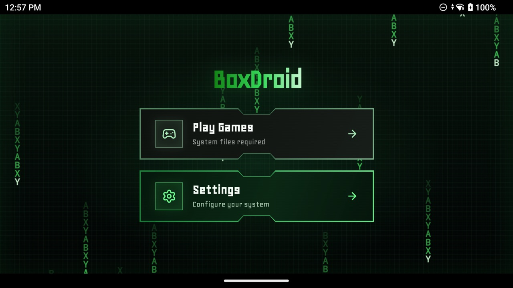
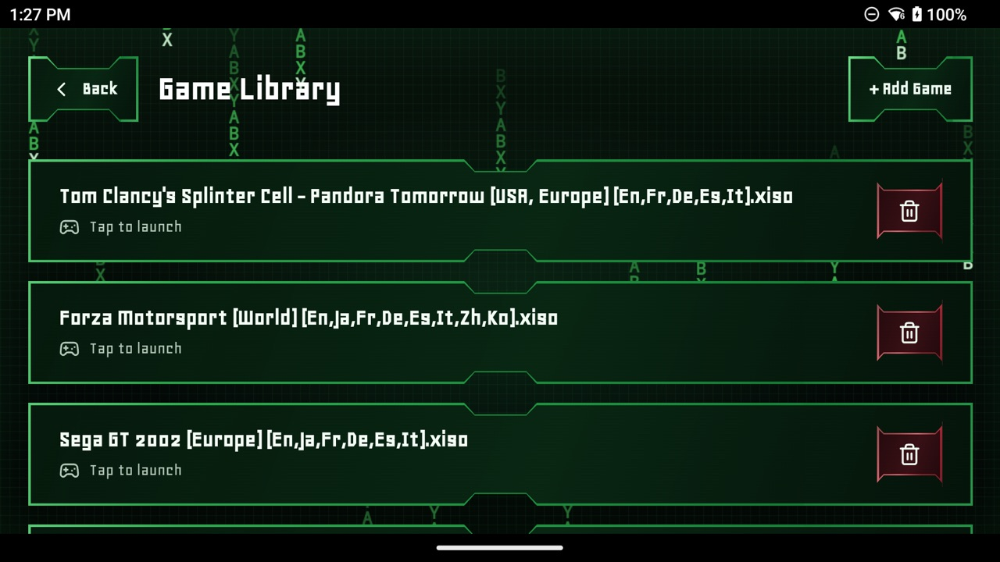
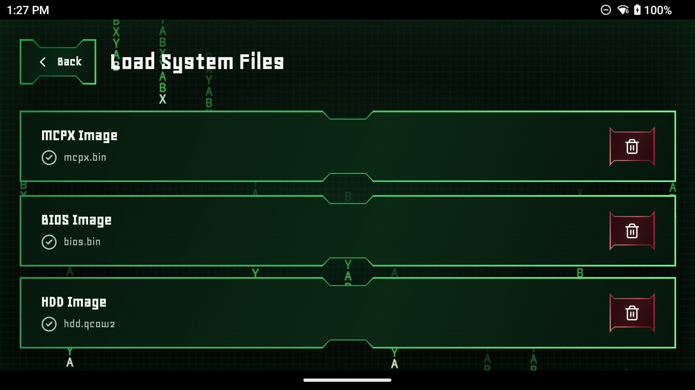

# BoxDroid

[](https://github.com/echeloon/BoxDroid/actions/workflows/ci.yml)
[](LICENSE)

An original Xbox emulator for Android, built on [Xemu](https://xemu.app/).

BoxDroid runs Xemu's emulation core (QEMU CPU emulation, the NV2A GPU on Vulkan,
the MCPX APU and DSP) inside a native Android app on arm64 devices. It adds an
Android Vulkan presenter, AAudio output, physical controller input and a
React-based frontend that runs in a local WebView.

> **Status: early development.** BoxDroid boots commercial games on a
> Snapdragon 865 device, but performance is below full speed in demanding
> scenes and compatibility has only been checked on a handful of titles.

| Main menu | Game library | System files |
| --- | --- | --- |
|  |  |  |

## Features

- Xemu core pinned to a fixed upstream commit, with an ordered, reviewable
  downstream patch series ([`patches/xemu`](patches/xemu)).
- Vulkan presentation with FIFO pacing on the Android surface.
- Optional custom Vulkan drivers (for example Turnip or newer Adreno drivers),
  loaded through [libadrenotools](native/android/driver/UPSTREAM.md) in an
  isolated validation process, with automatic fallback to the system driver.
- AAudio output and physical gamepad input mapped to an emulated Xbox
  controller.
- Runtime CPU topology discovery instead of hard-coded core numbers.

## Compatibility

Tested on a Retroid Pocket 5 (Snapdragon 865, Adreno 650, Android 13).

| Game | State | Notes |
| --- | --- | --- |
| Tom Clancy's Splinter Cell: Pandora Tomorrow | In-game | Menus, cutscenes and gameplay reached with controller input. |
| Forza Motorsport | In-game | About 28–29 FPS settled in race ([report](docs/performance/forza-hotlap-maple-valley-20261025.md)); a stable 30 FPS full lap is not established yet. |
| Sega GT 2002 | Profiled | Used as a sustained-load benchmark ([report](docs/performance/snapdragon-865.md)). |

Other games have not been tested. Reports from other devices are welcome.

## Requirements

**To run:** an arm64 (`arm64-v8a`) device on Android 13 (API 33) or newer with
Vulkan support, plus your own dumps of the Xbox BIOS, the MCPX boot ROM, an HDD
image and the games you own.

**To build:**

1. A supported host: **macOS** (Intel or Apple Silicon), **Linux x86_64**, or
   **Windows via WSL2** (as a Linux x86_64 host). The Android NDK provides no
   Linux ARM64 host toolchain.
2. **Android NDK** 30.0.16248370 (the version pinned by the Gradle build).
3. **Android SDK / Platform Tools** (for Gradle and ADB deployment).
4. **JDK 17** (for Gradle).
5. **Node.js & npm** (for building the React web frontend).
6. Host build tools: `git`, `python3` (with `venv`), `ninja`, `cmake`,
   `pkg-config`, `rustup`, `file`, and a C compiler (Xcode Command Line Tools
   on macOS, `cc` on Linux).

The build scripts read these environment variables:

| Variable | Purpose | Default when unset |
| --- | --- | --- |
| `ANDROID_HOME` / `ANDROID_SDK_ROOT` | Android SDK location | `~/Library/Android/sdk` (macOS), `~/Android/Sdk` (Linux) |
| `ANDROID_NDK_HOME` | Android NDK location | `$ANDROID_HOME/ndk/30.0.16248370` |
| `JAVA_HOME` | JDK used by Gradle | the `java` found on `PATH` |
| `ANDROID_SERIAL` | Device used by `adb` when several are connected | the only connected device |

## Building and running

One script syncs the submodule, applies the patch series, builds the native
libraries with Meson/Ninja, builds the web frontend with Vite, packages the APK
with Gradle and installs it on a connected device:

1. Connect an Android 13+ arm64 device via USB and authorize ADB debugging
   (`adb devices`).
2. Run:
   ```bash
   ./scripts/build-android.sh
   ```

Set `BOXDROID_INSTALL=0` to build without installing. Native libraries are
rebuilt incrementally on every run; delete `build/` for a clean build. The first
build downloads and compiles all native dependencies and takes a while.

### Setting up the emulator

1. Open **Settings → Load System Files** and select your MCPX, BIOS and HDD
   images.
2. Open **Play Games → Add Game** and select a `.iso` / `.xiso` game image.
3. Tap the game to start it.

Files are opened through Android's file picker, so BoxDroid needs no storage
permission. If you reinstall the app, select the files again.

### Logs

```bash
adb logcat -s BoxDroid BoxDroid_ BoxDroid_Game BoxDroid3 BoxDroidAudio BoxDroidGamepadInput BoxDroid-Driver
```

`BoxDroid3` carries opt-in diagnostics from the patched Xemu core.

## Repository structure

| Path | Contents |
| --- | --- |
| `android/` | Android app: activities, JNI bridges, controller input, driver management |
| `web-frontend/` | React frontend shown in the app's WebView |
| `native/android/core/` | Native BoxDroid runtime: JNI entry points, Vulkan presenter, audio and input bridges |
| `native/android/driver/` | Custom Vulkan driver loader (vendored libadrenotools) |
| `upstream/xemu/` | Upstream Xemu submodule, pinned |
| `patches/xemu/` | Downstream patch series applied to Xemu |
| `scripts/` | Build, profiling and analysis scripts |
| `tests/native/` | Host-side unit tests |
| `docs/` | Driver validation and performance reports |

## Contributing

Bug reports, compatibility reports and pull requests are welcome. Please:

- Keep changes to the Xemu core as small patches in `patches/xemu/` and follow
  the rules in [its README](patches/xemu/README.md).
- Include the device, Android version and game for compatibility reports, and
  attach a `logcat` capture for bugs.
- Make sure CI passes: Python unit tests, script checks, frontend lint/build and
  the Android build.

## Legal

BoxDroid is not affiliated with or endorsed by Microsoft or the Xemu project.
It does not include any BIOS, boot ROM, system software or games. You must dump
these yourself from hardware you own.

## License

BoxDroid is licensed under the [GNU General Public License v2.0](LICENSE), the
license of the Xemu and QEMU code it is built on. Vendored third-party
components keep their own licenses; see
[`native/android/driver/UPSTREAM.md`](native/android/driver/UPSTREAM.md) and the
notices in `android/app/src/main/assets/third-party-notices/`.
